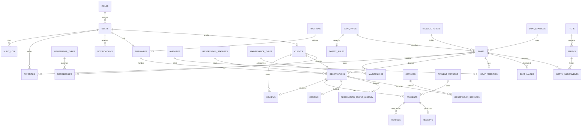

# Модель данных Yacht Club Manager

## ER-связи



## Нормализация

- **1НФ:** каждое поле содержит одно значение; фотографии, удобства и услуги вынесены в связанные таблицы.
- **2НФ:** в таблицах связей `boat_amenities`, `reservation_services`, `favorites` неключевые атрибуты зависят от полного составного ключа.
- **3НФ:** роли, должности, типы яхт, производители, статусы, членства, способы оплаты и виды обслуживания вынесены в справочники. Профиль клиента/сотрудника отделён от учётной записи, а снимок цены услуги хранится в строке заказа как исторический факт.
- Платёж, возврат, квитанция, аренда и история статуса — отдельные сущности, так что изменение текущего состояния не переписывает финансовую и операционную историю.
- Пересечение временных интервалов одной яхты запрещает PostgreSQL exclusion constraint с `tstzrange` и `btree_gist`. Отменённые, отклонённые и истёкшие заявки в него не входят.

## Представления и функции

`vw_boat_catalog`, `vw_active_reservations`, `vw_payment_summary`, `vw_monthly_analytics`, `vw_client_statistics`, `vw_boat_statistics`.

`fn_get_available_boats`, `fn_calculate_reservation_total`, `fn_get_client_balance`, `fn_get_monthly_revenue`, `fn_get_fleet_utilization`, `fn_get_boat_popularity`.

## Запросы для демонстрации PostgreSQL

```sql
-- Клиенты без заявок (LEFT JOIN)
SELECT c.client_id, c.first_name, c.last_name
FROM clients c LEFT JOIN reservations r USING (client_id)
WHERE r.reservation_id IS NULL;

-- Типы яхт, превысившие заданный объём бронирований (GROUP BY / HAVING)
SELECT bt.name, count(*) AS orders
FROM reservations r JOIN boats b USING (boat_id) JOIN boat_types bt USING (boat_type_id)
WHERE r.status_code NOT IN ('cancelled','rejected')
GROUP BY bt.name HAVING count(*) >= 5 ORDER BY orders DESC;

-- Цена яхт выше средней (подзапрос)
SELECT name, daily_rate FROM boats
WHERE daily_rate > (SELECT avg(daily_rate) FROM boats WHERE NOT is_archived);

-- Выручка и её изменение (CTE / LAG)
WITH monthly AS (
  SELECT date_trunc('month', confirmed_at)::date AS month, sum(amount) AS revenue
  FROM payments WHERE status IN ('confirmed','partially_refunded')
  GROUP BY 1
)
SELECT month, revenue, lag(revenue) OVER (ORDER BY month) AS previous_month
FROM monthly ORDER BY month;

-- Рейтинг яхт (RANK)
SELECT boat_name, booking_count,
       rank() OVER (ORDER BY booking_count DESC) AS popularity_rank
FROM vw_boat_statistics;

-- Условная агрегация вместо T-SQL PIVOT
SELECT status_code, count(*) FILTER (WHERE created_at >= date_trunc('month',now())) AS this_month,
       count(*) FILTER (WHERE created_at < date_trunc('month',now())) AS earlier
FROM reservations GROUP BY status_code;
```
